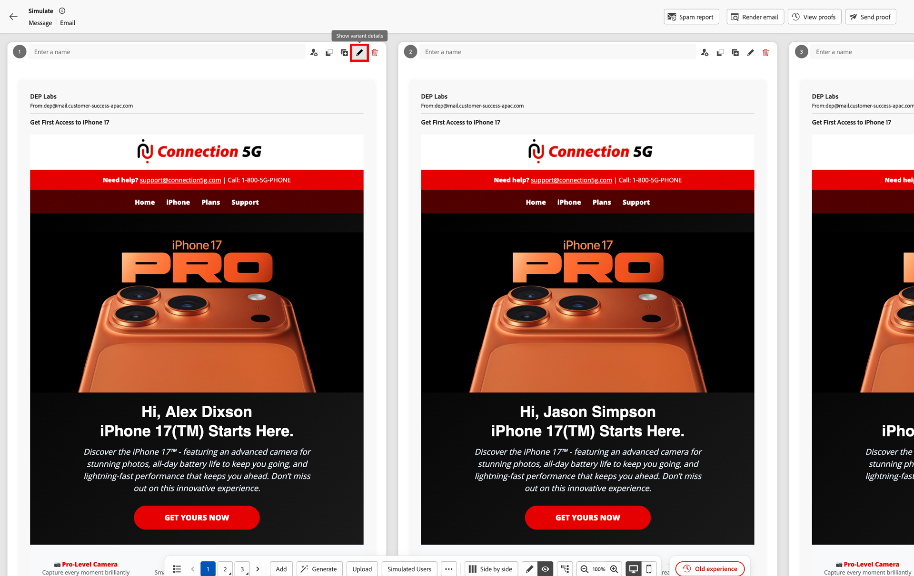
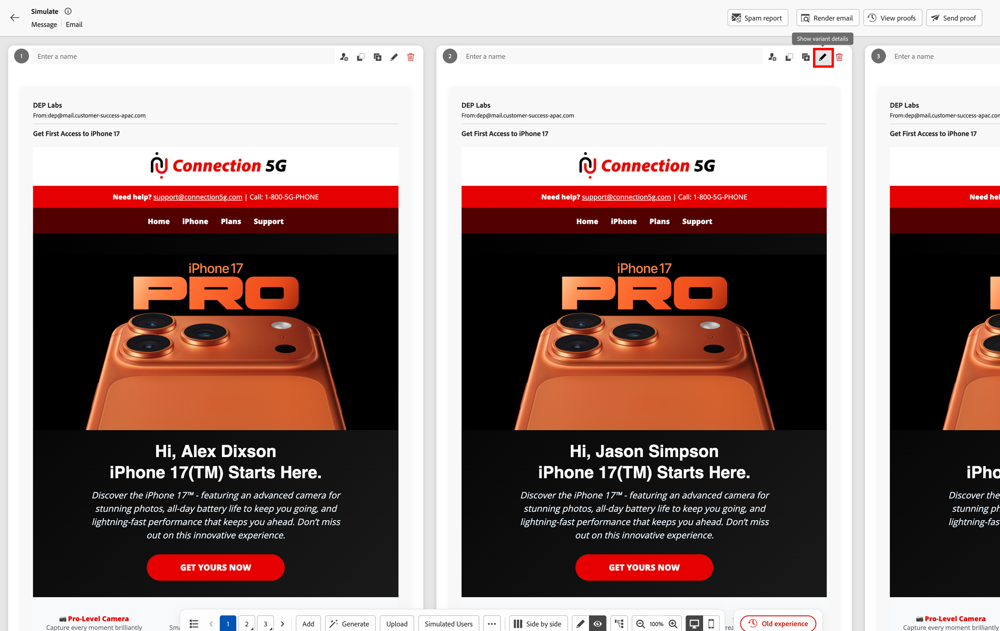

# 内容模拟

**用途：**&#x200B;使用Adobe Journey Optimizer的模拟和验证工具验证个性化、条件逻辑和内容变体。

## 学习目标

在本模块结束时，您将能够：

1. 上传并使用测试配置文件数据进行模拟。
1. 验证个性化字段和变量逻辑。
1. 测试缺少或不匹配数据的回退行为。

## 简介

在本模块中，您将使用Adobe Journey Optimizer中的模拟工具通过&#x200B;**两个条件变体**&#x200B;测试电子邮件。
这样，您可以预览不同客户将会如何体验您的个性化消息，确保在启动营销活动之前保持准确性。

您将使用工具包中的示例测试配置文件文件&#x200B;**sample.csv**。

## 打开模拟工具

1. 打开您填写好的电子邮件。
2. 在电子邮件中，单击&#x200B;**模拟内容**。

几秒钟后会打开模拟面板。

## 上传测试配置文件数据

1. 单击底部的&#x200B;**上传**&#x200B;以上传输入数据。

   在模拟面板中上载输入数据的

&#x200B;3. 选择&#x200B;**sample.csv**&#x200B;并单击&#x200B;**继续**。

   

AJO会处理文件，并及时准备预览。

## 查看变体渲染

当您单击模拟电子邮件中的内容时，AJO会根据上传的用户档案并排显示变体。

**预期结果：**

- **Alex**→看到&#x200B;**变体1**（年龄超过40岁）
单击第一个变量上方的铅笔图标以&#x200B;**显示变量详细信息**

卡片将翻转以显示个性化所基于的详细信息

- **Jason** →看到&#x200B;**变体2** （年龄低于40岁）
单击第二个变量上方的铅笔图标以&#x200B;**显示变量详细信息**

将视图从并排切换到&#x200B;**垂直栈叠**&#x200B;以并排查看Jason的详细信息和个性化

在滚动电子邮件内容时，我们可以看到Jason的全名以及我们选择的条件内容图像。 太酷了！

在变体2中为Jason显示了个性化全名字段

## 验证回退行为

**回退和默认值：**&#x200B;检查您的电子邮件是否正常处理任何丢失的数据或不匹配的情况。 例如，模拟出生年份字段为空的用户档案或不符合任何定向优惠条件的用户档案。 预览应显示默认内容块或合理的占位符，而不是损坏或空的内容。 如果您的模拟显示了一个内容应位于的空部分，这表示您可能需要在设计中配置后备选件或默认文本。

## 回顾

在本模块中，您已成功：

- 使用样本个人资料的模拟个性化内容
- 已验证的变体切换逻辑
- 已确认个性化字段已正确填充

您现在已准备好学习下一模块 — **品牌一致性**，
在这里，您将使用AI根据Connection 5G品牌准则评估电子邮件。
