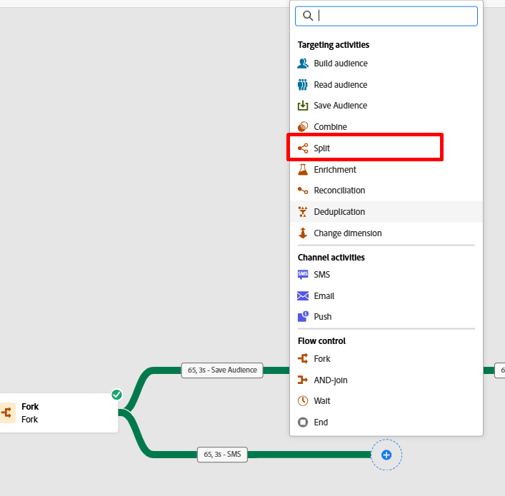
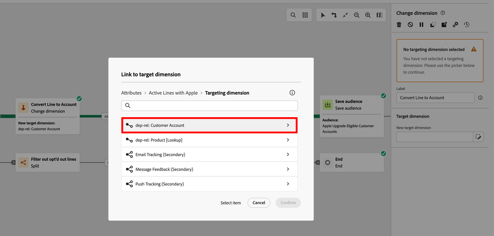

# 筛选行

## 目标

在接下来的步骤中，您将过滤掉实际上不允许使用短信消息定向的所有行，因为这些行在行级别被禁用。  在此不能依赖配置文件同意，因为这是行级目标。

## 设置拆分活动

1. 单击“分支”活动底部过渡处的&#x200B;**+**&#x200B;图标，然后在弹出窗口中选择&#x200B;**Split**&#x200B;活动。

   

2. 在右边栏中，更新标签以声明以下内容： `Filter out opt'd out lines`

   

3. 在右边栏中，展开默认区段&#x200B;**子集**&#x200B;部分，然后单击&#x200B;**创建过滤器**&#x200B;按钮

   

4. 添加条件以确保您删除所有选择禁用短信消息的客户行，然后单击&#x200B;**确认**。

   

   >[!NOTE]
   >
   >您需要了解如何创建条件，但最终结果与上面的屏幕快照匹配。  你搞定了！

5. 单击右上角的“保存”按钮以保存您所做的工作。  你的画布现在看起来好像\...

保存拆分活动后

## 添加更改维度

1. 在工作流画布上，单击添加的分割条件后面的&#x200B;**+**&#x200B;图标，然后选择&#x200B;**更改维度**&#x200B;活动

   

2. 更新如下所述的更改维度的属性，然后单击&#x200B;**确认**：
标签： `Convert Line to Account`
新目标维度： `dep-rel: Customer Account`

   

   

## 添加短信活动

1. 在添加的“更改”维度后单击&#x200B;**+**&#x200B;图标，然后选择&#x200B;**手机消息活动**

   

   

2. 在右边栏中，单击&#x200B;**编辑移动设备消息**&#x200B;按钮以开始配置短信消息

   右边栏中的

3. 在顶部导航中，单击操作菜单项，然后从移动设备消息配置下拉列表中选择您之前创建的渠道。

>[!CAUTION]
>
>哦，不🫨！  为什么没有结果？  您尚未设置短信渠道吗？  产品是否损坏？
>
>吓坏了!!!!!!!!!

## 惊慌时刻

短信的渠道配置已由您预先设置，当前看起来是……

**阅读方式如下：**

- 针对在辅助维度（即客户行）中找到的相关记录数，为每个目标维度（即客户帐户）投放一条消息
- 使用在次要维度（即客户线路）中找到的手机号码执行每次短信投放

这种将许多消息发送到一个用户档案的独特功能是编排营销活动的主要功能之一，使其与历程有所不同。 但是，您进入移动消息活动的过渡设置为“客户帐户”。 这样，您就可以在发送时将它加入Real-time Customer Profile，以便将消息中的投放和跟踪信息归因于用户档案。

那么你怎样才能让这个运作起来呢？ 更改消息执行的目标以匹配您的渠道配置😀

## 更改Target并完成短信消息配置

1. 单击短信编辑屏幕上的返回按钮

   

2. 选择移动设备消息活动后，在右边栏中，首先将Target选项从每个配置文件一个消息的默认选项更改为&#x200B;**每个辅助维度一个消息**&#x200B;选项，然后单击返回&#x200B;**编辑移动设备消息**

   

3. 在顶部导航中，单击&#x200B;**操作**&#x200B;菜单项，然后从移动消息配置下拉列表中选择您之前创建的渠道。

   

## 回顾

您过滤掉所有因选择退出而不允许使用短信消息进行定位的行，将维度从行更改为帐户，并最终为允许进行定位的用户成功配置了短信活动。
希望您也了解了一件非常重要的事情 — **您的目标必须与要使用的渠道配置相匹配**
