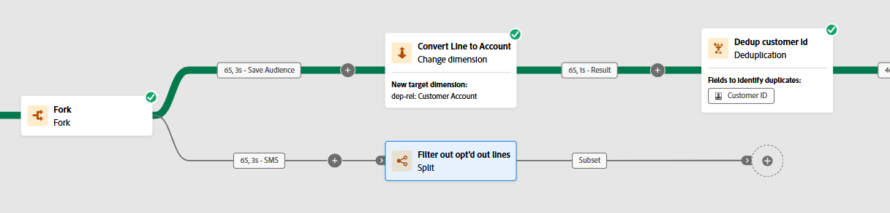

# 筛选行

## 目标

在接下来的步骤中，您将过滤掉实际上不允许使用短信消息定向的所有行，因为这些行在行级别被禁用。  在此不能依赖配置文件同意，因为这是行级目标。

## 设置拆分活动

1. 单击“分支”活动底部过渡处的&#x200B;**+**&#x200B;图标，然后在弹出窗口中选择&#x200B;**Split**&#x200B;活动。

   

2. 在右边栏中，更新标签以声明以下内容： `Filter out opt'd out lines`

   

3. 在右边栏中，展开默认区段&#x200B;**子集**&#x200B;部分，然后单击&#x200B;**创建过滤器**&#x200B;按钮

   

4. 添加条件以确保您删除所有选择禁用短信消息的客户行，然后单击&#x200B;**确认**。

   

   >[!NOTE]
   >
   >您需要了解如何创建条件，但最终结果与上面的屏幕快照匹配。  你搞定了！

5. 单击右上角的“保存”按钮以保存您所做的工作。  你的画布现在看起来好像\...

保存拆分活动后

## 添加短信活动

1. 在工作流画布上，单击添加的分割条件后面的&#x200B;**+**&#x200B;图标，然后选择&#x200B;**移动消息活动**

   

   

2. 在右边栏中，单击编辑移动设备消息按钮以开始配置短信消息

   右边栏中的

3. 在顶部导航中，单击操作菜单项，然后从移动设备消息配置下拉列表中选择您之前创建的渠道。

## 回顾

您过滤掉了所有因选择退出而不允许使用短信消息进行定位的行，并为允许进行定位的用户添加了短信活动。
